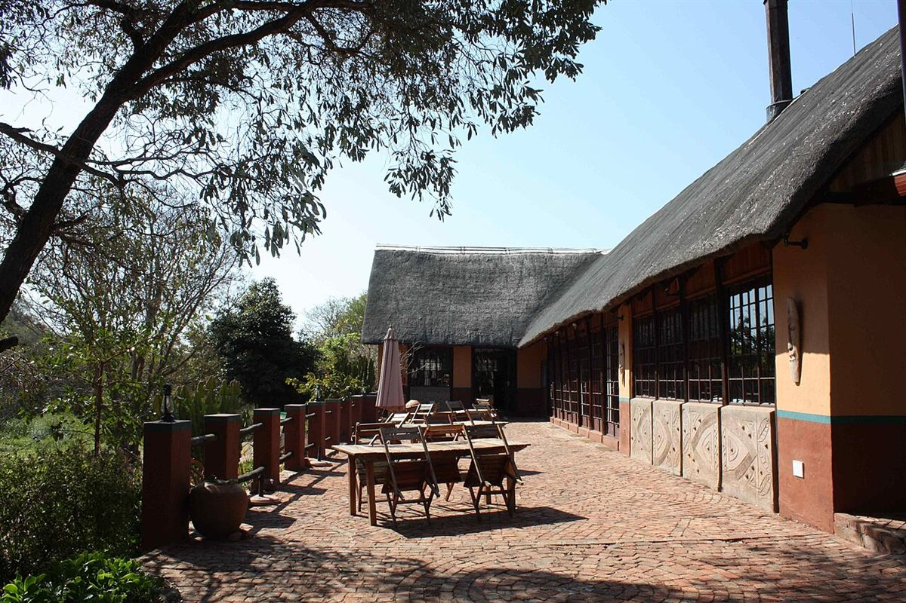

# SkyRidge Lodge — Billing & Management System

A complete desktop lodge management suite built with **Java + JavaFX**, grown from the original
ICT261 class exercise into a full front-desk application with room inventory, reservations,
guest profiles, invoicing, payments, reporting and persistent storage.



---

## 1. Quick start
### Requirements For Development
To do anything regarding the CSS you need sass, to install sass and task
you will need node js and npm to install sass
```bash
npm i -g sass
```

and as for taskfile you will need to READ THE FOLLOWING INSTRUCTIONS [Here](https://taskfile.dev/)

### Running a DEV Server 
cd into the Project Dir and type 
```bash
task 
```
#### For css dev Server
run the following
```bash
task dev:css
```
## To Run as a NORMAL USER 

Type 
```bash
gradle run
```

**First sign-in**

On a fresh installation, create the administrator account on the first-run setup
screen. The name and username default to `Achizima`; set a private password there.
After setup, staff sign in with accounts created by the administrator. Customers
can create their own account from the sign-in screen, browse rooms and place
reservations from this desktop application. Customer accounts do not have access
to staff operations. This is a local desktop booking flow, not a public website.

---

## 2. Modules

| Module | What it does |
|--------|--------------|
| **Dashboard** | Live occupancy %, rooms occupied/free, money collected today, outstanding balances, today's arrivals & departures, latest invoices, photo gallery of the property. |
| **Rooms** | Photo cards for every room and cottage with live status (Available / Reserved / Occupied / Maintenance), nightly rate and features. Add, edit, delete and filter rooms. |
| **Reservations** | Book a free room for a date range (only rooms free for those dates are offered), live stay estimate, check-in, check-out (raises the invoice automatically) and cancellation. |
| **Guest book** | Searchable guest profiles: name, phone, email, ID/passport, nationality and notes. |
| **Customer booking** | Customer self-registration, room and date availability, self-service reservations and personal booking history. |
| **Staff accounts** | Staff-only account list, account creation, and admin-only customer login deletion while retaining guest/booking history. |
| **Billing** | Walk-in invoices, extra charges from the price list, part payments (cash / mobile money / card / bank transfer), voiding, and a printable receipt. Double-click a bill to open its receipt. |
| **Reports** | Revenue by room type, payments by method (pie), billed vs. collected over six months, best-selling extras, KPI tiles and a month selector. |
| **Accounting** | Accountant/admin-only financial workspace: date-based receipts, cash/mobile money/bank/card totals, invoice ageing, supplier expenses and payments, CSV exports and financial activity. Accountants always see detail; administrators start with a summary and can explicitly open detail. |
| **Menu → Help** | Rates & billing rules, audit trail of everything users have done, and the About box. |

---

## 3. Business rules

* **Room rates** (per night): Standard `K 350` · Deluxe `K 550` · Family `K 750` ·
  Executive Suite `K 1,200` · VIP Thatched Cottage `K 1,500`.
* **Long-stay discount**: stays of **5 nights or more earn 5% off the room charge**.
  Extra services are never discounted.
* **VAT**: 16% is applied to the discounted subtotal.
* **Balance** = total − payments received. A bill is `Paid in full` once the balance hits zero.
* Check-out raises the bill; the room returns to *Available* and the booking stores the bill id.

---

## 4. Architecture

```
src/main/java/com/lodge/
├── MainApp.java              entry point, loads the login scene
├── model/                    plain entities (no UI code)
│   ├── User, Role            staff/customer accounts and permission matrix
│   ├── Room, RoomType, RoomStatus
│   ├── Guest
│   ├── Booking, BookingStatus
│   ├── Bill, BillLine, BillStatus, Payment, PaymentMethod
│   ├── ServiceItem, ServiceCategory      extras price list
│   └── AuditEntry            audit trail rows
├── service/                  business logic + persistence (singletons)
│   ├── AuthService           staff/customer login, registration, permissions, audit log
│   ├── RoomService           inventory, availability, status changes
│   ├── GuestService          guest book, find-or-create for walk-ins
│   ├── BookingService        bookings, check-in/out, room synchronisation
│   ├── BillingService        invoices, extras, payments, price list
│   ├── ReportService         dashboard + report analytics
│   └── DataStore             JSON persistence (~/.lodge-billing)
├── controller/               JavaFX controllers (one per screen)
└── util/                     Money, PasswordUtil (SHA-256), JsonAdapters, FxImages

src/main/resources/com/lodge/
├── view/*.fxml               login, main shell and the six module screens
├── css/style.css             full theme
└── images/*.jpg              lodge, rooms, pool and restaurant photographs
```

**Key design points**

* **MVC**: models never touch JavaFX, services never touch the scene graph, controllers never
  hold business rules.
* **Singleton services** keep one shared state; the shell (`MainController`) rebuilds each
  module whenever it is navigated to, so data is always fresh.
* **Persistence**: every change is written straight away to JSON files in `~/.lodge-billing`
  (users, rooms, guests, bookings, bills, services, audit). Delete that folder to start from
  the seeded demo data again.
* **Security**: passwords are stored as hashes (`util/PasswordUtil`), never in clear text.
  Legacy demo accounts are removed once from an existing data store. Staff account creation
  requires an administrator session. Customer accounts are linked to guest profiles, and
  `Role.Permission` prevents customers from accessing staff operations.
* **Audit trail**: logins, bookings, check-ins, payments, edits and deletions are recorded with
  user and timestamp (Help ▸ Audit trail).

### Accountant workspace

The **Accounting** navigation item and financial reports are available only to `ACCOUNTANT`
and `ADMIN` accounts. The accounting service checks access again for every read, export and
change. Accountants land on the detailed workspace after sign-in. An administrator opens a
summary first and can choose **Open detailed view**; returning to the module starts in summary
again. Detailed invoice/customer/payment rows are not returned in summary mode.

The detailed workspace contains Overview, Payments, Outstanding, Expenses and Reports:

* Select an inclusive date range for invoices, receipts, expenses and exports. Receipts use
  the actual payment date, including payments against older invoices. Outstanding customer
  and supplier balances are current balances across all dates.
* Cash, Mobile Money and Bank Transfer are explicit collection methods and filters. Card
  remains supported for existing records. Voiding an invoice does not erase cash already
  received; such receipts are flagged for review.
* Outstanding invoices are grouped by days past their due date. Existing invoices default
  to due on issue; an accountant or administrator can save a different due date.
* Record real supplier bills, their total and included VAT, supplier references, category,
  issue/due dates, and full payment details. Bank, mobile money and card supplier payments
  require a reference. Supplier expenses persist in `~/.lodge-billing/expenses.json` and use
  strict file replacement; failed saves do not publish an unsaved expense in memory.
* Export the period's payment/invoice/expense registers, current outstanding accounts, or
  the financial summary as UTF-8 CSV. Table searches filter the display; register exports
  contain all records for the selected dates (all dates for current outstanding accounts).
* The receipt comparison checks recorded receipts against a manually entered cash count or
  statement receipt total. It does not import statements or mark transactions reconciled.

Supplier payments currently settle a supplier bill in full. Expense VAT is entered from the
supplier document, not inferred automatically. Reports cover recorded transactions; they
are not a complete general ledger, profit and loss statement, tax return or bank integration.
Room-service and room-customization modules are reserved for separate work and are not
implemented by this feature.

---

## 5. Example property data

The lodge room inventory, guest, reservation, invoice and service examples help demonstrate
the application modules. They are not demo accounts and can be managed in the system.

---

## 6. Images

All photographs bundled in `src/main/resources/com/lodge/images` were sourced from
**Wikimedia Commons** (freely licensed) and are used here for a student demonstration:

| File | Source file on Commons |
|------|------------------------|
| `hero-lodge.jpg` | Mashovhela Bush Lodge, Limpopo, South Africa |
| `cottage.jpg` | Mosetlha Bush Camp & Eco Lodge, Madikwe |
| `garden-cabin.jpg` | Jaci's Lodges, Madikwe Game Reserve |
| `pool.jpg` | Negombo Beach resort pool |
| `restaurant.jpg` | Lions Bluff Lodge restaurant, Kenya |
| `room-standard.jpg` / `room-family.jpg` | *Bed in hotel room 5 / 3* |
| `room-deluxe.jpg` | Princess Luxury Hotels – Bedroom |
| `room-executive.jpg` | Khan Pool Suite, Amantaka, Luang Prabang |
| `suite-view.jpg` | Hotel Italia Palace bedroom |
| `aerial-lodge.jpg` | Ever Bloomfield pool and lodge exterior, Daintree Coast |

Drop your own photographs into that folder with the same names to brand the system with the
real lodge.

---

## 7. Building & running

```bash
gradle build        # compile
gradle run          # start the application
gradle installDist  # create a distributable launch script
```

Requirements: JDK 21+ and Gradle 8/9. The JavaFX SDK (21.0.6) and Gson are pulled in
automatically by the Gradle JavaFX plugin.
